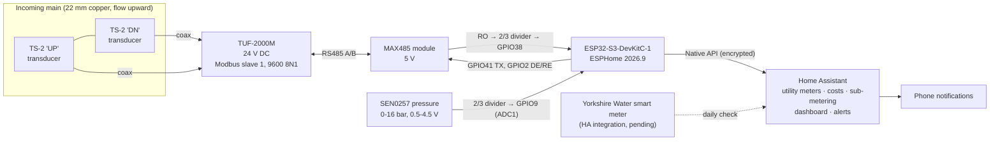
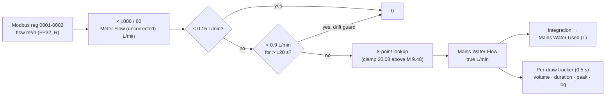

# Mains Water Monitor: TUF-2000M Ultrasonic Flow + SEN0257 Pressure on ESPHome and Home Assistant

**Non-invasive whole-house water metering with per-draw tracking, cost, sub-metering and pressure.** It uses a clamp-on ultrasonic flow meter read over RS485/Modbus RTU by an ESP32-S3 running ESPHome, with the data sent to Home Assistant.

[](https://www.youtube.com/channel/UC5Cupmz7vlfcodpCX7k8iuQ)


> **The short version:** the meter reads only **35-52 %** of the real flow on 22 mm copper, and stops rising altogether at about **20 L/min**. I tested it against marked buckets, mapped the error and corrected it on the ESP32 with an 8-point lookup table. Normal draws now agree with the bucket to **±3-5 %**. Every litre, every draw and every penny is visible in Home Assistant.


---

## Contents

1. [Objective](#1-objective)
2. [Scope](#2-scope)
3. [Deliverables](#3-deliverables)
4. [System architecture](#4-system-architecture)
5. [Results at a glance](#5-results-at-a-glance)
6. [Issues dealt with](#6-issues-dealt-with-summary)
7. [Testing](#7-testing-summary)
8. [Outputs](#8-outputs)
9. [Benefits](#9-benefits)
10. [Video series](#10-video-series)
11. [Quick start](#11-quick-start)
12. [Repository map](#12-repository-map)
13. [Roadmap](#13-roadmap)
14. [Skills demonstrated](#14-skills-demonstrated-bms--building-automation)
15. [Disclaimer and licence](#15-disclaimer-and-licence)

---

## 1. Objective

Measure the mains cold water entering a house **without cutting the pipe**, and turn that measurement into useful information:

- **How much:** live flow (L/min) and running totals by day, month, quarter and billing period.
- **How much it costs:** live £ per draw and per period, using the real water and sewerage tariff.
- **What used it:** each draw recorded with volume, duration and peak flow, plus event sub-metering for showers and the washing machine.
- **Is something wrong:** leak or drift alerts and meter-health diagnostics.
- **What pressure:** mains pressure trend from the same board.
- **Is it right:** cross-check against the water company's smart meter once it goes live.

A second aim was to treat the project as a **building-automation exercise**: a real Modbus RTU field device, RS485 physical layer, signal conditioning, field calibration, alarm design and an operator dashboard. It is the domestic equivalent of a BMS metering point.

## 2. Scope

| In scope | Out of scope (for now) |
|---|---|
| Clamp-on TUF-2000M on the incoming main (22 mm copper) | Cutting in an inline meter |
| RS485 / Modbus RTU link to an ESP32-S3 (ESPHome) | Hot-water flow metering |
| Field calibration against measured volumes and a software correction | Lab-grade accuracy or certification |
| DFRobot SEN0257 mains pressure sensor on the same board | Boiler / heating pressure (separate project) |
| Home Assistant: totals, tariffs, per-draw tracking, sub-metering, dashboards, alerts | Valve control or automatic shut-off |
| Diagnostics: signal quality, travel-time ratio, strengths, error code | Water-company billing replacement |

## 3. Deliverables

| # | Deliverable | Where | Status |
|---|---|---|---|
| D1 | Installed and configured TUF-2000M (TS-2 transducers, W method) | [docs/02](docs/02-meter-installation-and-configuration.md) | ✅ |
| D2 | RS485 interface with a safe 5 V to 3.3 V receive divider | [docs/01](docs/01-hardware-and-wiring.md) | ✅ |
| D3 | Verified Modbus register map (addressing and word order) | [docs/03](docs/03-modbus-register-map.md) | ✅ |
| D4 | Calibration dataset and fitted correction table | [docs/04](docs/04-calibration-and-testing.md), [data/](data/) | ✅ |
| D5 | ESPHome firmware: corrected flow, totals, per-draw tracker, pressure, diagnostics | [config/esphome](config/esphome/esp32-utility-room.yaml) | ✅ |
| D6 | HA utility meters, tariff and cost sensors, bill-period counter | [config/homeassistant](config/homeassistant/) | ✅ |
| D7 | Sub-metering: master en-suite shower and washing machine | [docs/05](docs/05-home-assistant-integration.md) | ✅ (more planned) |
| D8 | Dashboard: 14 gauges, status panel, bill panel, draw chart, pressure graph | [config/dashboards](config/dashboards/water-view.yaml) | ✅ |
| D9 | Steady-low-flow (drift / slow-leak) phone alert | [automations.yaml](config/homeassistant/automations.yaml) | ✅ tested |
| D10 | Issues log and lessons learned | [docs/06](docs/06-issues-and-lessons-learned.md) | ✅ |
| D11 | Sensors-slipped alert, pipe-temperature NTC, water-company cross-check | [docs/07](docs/07-roadmap.md) | ⏳ |

## 4. System architecture



**Signal chain inside the ESP32:**



## 5. Results at a glance

| Measure | Result |
|---|---|
| Raw meter accuracy on 22 mm copper | **35-52 % of true volume**, flow dependent (best at about 12-18 L/min) |
| Meter saturation | Meter flow stops rising at about **9.5 L/min displayed** (about 20 L/min true) |
| Corrected accuracy, normal draws (2.5-12 L/min) | **±3-5 %** against marked buckets |
| Corrected accuracy, fast draws (about 20 L/min) | **±8 %**; flows above about 20 L/min read as 20 |
| Very short, fast draws (< 40 s) | Up to 11-12 % low (start/end edge effects) |
| Lowest flow counted | About 0.4 L/min (below that is dead band) |
| Signal quality in service | Q 83-88 %, travel-time ratio 102.9-104.3 % |
| Modbus reliability | 48/48 flow polls on time over 47 s after the timing fix; no parse failures |
| Mains pressure | 3.0-4.0 bar; about 0.07 bar sag while drawing |
| Real showers measured | 140 L in about 9 min, 200 L in about 12 min (about 16 L/min) |


## 6. Issues dealt with (summary)

Full write-ups, with symptom, cause, fix and evidence for each, are in **[docs/06-issues-and-lessons-learned.md](docs/06-issues-and-lessons-learned.md)**.

| # | Issue | Fix |
|---|---|---|
| 1 | Meter reads 35-52 % of true flow | Bucket calibration, then an 8-point lookup table in the ESP32 |
| 2 | Meter saturates near 9.5 L/min displayed | Clamp output at 20.08 L/min; "Flow At Meter Limit" diagnostic |
| 3 | Zero drift and phantom flow after a draw | Zero reset with no flow, dead band, 120 s drift guard, steady-low-flow alert |
| 4 | Modbus values off by one register | Address = manual number − 1, `FP32_R` (low word first) |
| 5 | Totaliser "jumping" by thousands | Was reading half of two different registers; read float total at address 114 |
| 6 | Signal strength exactly 2× wrong | Raw count scale is 0.0244, not 0.0488 |
| 7 | ESPHome 2026.9 Modbus stalls (2 s dead bus) | `send_wait_time: 400ms`, `turnaround_time: 100ms`, second slow controller |
| 8 | `skip_updates` retired in 2026.9 | Two `modbus_controller`s at the same address (1 s and 60 s) |
| 9 | 5 V RS485 and sensor outputs vs a 3.3 V ESP32 | 10k/10k/10k dividers (2/3 ratio) on RX and ADC |
| 10 | Utility meters inherited 8.9 million litres of junk | `utility_meter.calibrate` to 0 after fixing the source |
| 11 | Two identical draws recorded as one | +0.001 L nudge on equal consecutive volumes |
| 12 | Small draws invisible on linear gauges | Gauge Card Pro with a square-root green zone |
| 13 | Phone alert silently failing | `notify.send_message` needs the notify entity, not the `mobile_app_` service name |
| 14 | Dashboard columns capped at about 500 px | Theme variable `ha-view-sections-column-max-width` |

## 7. Testing (summary)

Full method, every run and the analysis are in **[docs/04-calibration-and-testing.md](docs/04-calibration-and-testing.md)**. The raw data is in [data/](data/).

- **Reference:** marked 4 L, 10 L and 20 L containers, a stopwatch, and two taps downstream of the meter: the sink (up to about 8 L/min, limited by its aerator) and the outside tap (up to about 21 L/min). The stopcock was never touched.
- **Phase A:** baseline with the factory zero. This exposed the 35-49 % shortfall.
- **Phase B:** zero reset (M43, then M42 with no flow) and a transducer-type experiment. The zero was not the main cause.
- **Phase C:** the ESP32 recorded the meter's own raw litres per draw, so every bucket gave a clean ratio. Eleven runs from 2.5 to 21 L/min revealed saturation.
- **Verification:** eight 10 L draws on the fitted table, a 0.5 L glass test and a toilet flush.
- **Reliability:** Modbus timing captured from logs before and after the ESPHome timing fix.
- **Alerts:** the drift alert was fired and confirmed on the phone.

## 8. Outputs

**ESPHome entities** (device "ESP32 Utility Room")

| Group | Entities |
|---|---|
| Core | Mains Water Flow (L/min), Mains Water Used (L, restored), Mains Water Pressure (bar), Water Draw Active |
| Live draw | Current Draw Volume, Current Draw Time (m:ss stopwatch) |
| Last draw | Volume, Duration, Peak Flow, Finished (timestamp), Log (one-line summary), Draw Count |
| Diagnostics | Meter Flow (uncorrected), Last Draw Raw Volume, Low Flow Suppressed, Flow At Meter Limit |
| Meter Stats (60 s) | Velocity, Sound Speed, Total (Positive/Negative), Flow Today/Month, Signal Quality, Up/Down Strength, Travel Time Ratio, Error Code, Reynolds No., Pipe Factor, Working Timer |

**Home Assistant**

- **Utility meters:** daily, weekly, monthly, quarterly and yearly.
- **Costs:** today, month, quarter (with fixed charges), current draw, last draw and since last bill.
- **Bill counter:** a one-button "new bill starts now" that resets the period.
- **Sub-metering:** shower and washing-machine usage in m³ and £.
- **Dashboard:** 14 gauges, status and bill panels, a 24 h draws bar chart and a 24 h pressure trend.

## 9. Benefits

- **No plumbing work for flow:** clamp-on, reversible, no water-company seal touched.
- **Leak and drift awareness:** a steady low flow for 10 minutes triggers a phone alert.
- **Behaviour change:** live £ per draw makes shower length and tap habits visible. At about £5 per m³, a 140 L shower costs about £0.70.
- **Bill forecasting:** quarter-to-date cost, including fixed charges, before the bill arrives.
- **Appliance insight:** per-cycle washing-machine and per-shower volumes.
- **Independent check** on the water company's meter and estimates.
- **Transferable skills:** Modbus RTU, RS485, register maps, field calibration, alarm thresholds and operator dashboards are core BMS work.
- **Low cost, open stack:** ESPHome and Home Assistant, no cloud dependency.

## 10. Video series

This project is documented on my YouTube channel **[The Control Cabinet](https://www.youtube.com/channel/UC5Cupmz7vlfcodpCX7k8iuQ)**.

<!-- Replace each "Coming soon" with the episode link once published, e.g. [▶ Watch](https://youtu.be/VIDEO_ID) -->

| Ep | Topic | Video |
|---|---|---|
| 1 | The Hardware Setup: TUF-2000M clamp-on, ESP32-S3 over RS485, SEN0257 | [Available](https://www.youtube.com/watch?v=lkg-P0zSReg) |
| 2 | The Hardware Installation & Setup | [Available](https://www.youtube.com/watch?v=UxC-Y1Gd4TQ) |
| 3 | The Software Setup including Calibration & Dashboard | [Available](https://www.youtube.com/watch?v=0hYcSKB2rxw) |

📺 **Channel:** [The Control Cabinet on YouTube](https://www.youtube.com/channel/UC5Cupmz7vlfcodpCX7k8iuQ)

## 11. Quick start

> ⚠️ **The correction table is specific to this installation.** On a different pipe, transducer spacing or meter setting your error curve will differ. Run the calibration in [docs/04](docs/04-calibration-and-testing.md) and replace the `M[]` and `Q[]` arrays.

1. **Hardware:** wire as in [docs/01](docs/01-hardware-and-wiring.md). Fit the dividers before connecting RO or the sensor signal to the ESP32.
2. **Meter:** fit the transducers and set the M-menus in [docs/02](docs/02-meter-installation-and-configuration.md). Set zero only with the water truly off, then save with **M26**.
3. **ESPHome:** copy [`config/esphome/secrets.example.yaml`](config/esphome/secrets.example.yaml) to `/config/esphome/secrets.yaml`, then adopt [`esp32-utility-room.yaml`](config/esphome/esp32-utility-room.yaml). Flash by USB the first time and OTA after that.
4. **Home Assistant:** add [`input_number`](config/homeassistant/input_number.yaml), [`utility_meter`](config/homeassistant/utility_meter.yaml) and [`templates`](config/homeassistant/templates.yaml) to `configuration.yaml`, then do a full restart. Import the [automations](config/homeassistant/automations.yaml) and [script](config/homeassistant/scripts.yaml).
5. **Dashboard:** install Gauge Card Pro, apexcharts-card and card-mod from HACS, then paste [`water-view.yaml`](config/dashboards/water-view.yaml).
6. **Check entity IDs:** confirm in Developer tools → States and search/replace if your device or area names differ.
7. **Calibrate:** do bucket runs across your flow range and fit your own table.

## 12. Repository map

```
.
├── README.md                         ← you are here
├── CHANGELOG.md                      ← how the design evolved
├── LICENSE
├── docs/
│   ├── 01-hardware-and-wiring.md
│   ├── 02-meter-installation-and-configuration.md
│   ├── 03-modbus-register-map.md
│   ├── 04-calibration-and-testing.md
│   ├── 05-home-assistant-integration.md
│   ├── 06-issues-and-lessons-learned.md
│   ├── 07-roadmap.md
│   └── images/
├── config/
│   ├── esphome/        esp32-utility-room.yaml, secrets.example.yaml
│   ├── homeassistant/  templates, utility_meter, input_number, automations, scripts, themes/
│   └── dashboards/     water-view.yaml (complete), gauge-stack.yaml, right-column.yaml
└── data/               calibration_runs.csv, lookup_table.csv, verification_draws.csv
```

## 13. Roadmap

Highlights (full list in [docs/07-roadmap.md](docs/07-roadmap.md)):

- Cross-check daily totals against the Yorkshire Water smart meter once activated, and scale the table if there is a consistent bias.
- Sensors-slipped alert (quality, travel-time ratio, strengths, error code).
- Strap-on NTC for pipe temperature, since the meter's "sound speed" is not a thermometer.
- Investigate the 3.0-3.6 bar pressure oscillation at rest.
- More sub-metering: other showers and the dishwashers.

## 14. Skills demonstrated (BMS / building automation)

| Skill | Evidence in this project |
|---|---|
| Field-device integration (Modbus RTU / RS485) | Register map, word order, addressing, polling design, bus timing |
| Instrumentation and signal conditioning | Voltage dividers, ADC attenuation limits, sensor scaling |
| Commissioning and calibration | Structured test phases, reference volumes, fitted correction, verification runs |
| Fault finding | Off-by-one register diagnosis, saturation discovery, Modbus stall analysis |
| Alarm strategy | Drift guard, steady-low-flow alert, planned slipped-sensor alarm with baseline thresholds |
| Metering and energy/utility reporting | Utility meters, tariff model, billing periods, sub-metering |
| Operator interface (HMI) | Gauge dashboard with banded thresholds, status and diagnostics |
| Documentation | This repository |

## 15. Disclaimer and licence

This is a hobby project and not a certified meter. Work on the water supply at your own risk, and use a qualified plumber where needed. The pressure sensor tee and fittings must be rated for mains pressure. Released under the [MIT Licence](LICENSE).

*Built and documented by James, October 2026. Questions and comments are welcome on the [YouTube channel](https://www.youtube.com/channel/UC5Cupmz7vlfcodpCX7k8iuQ) or in Issues.*
