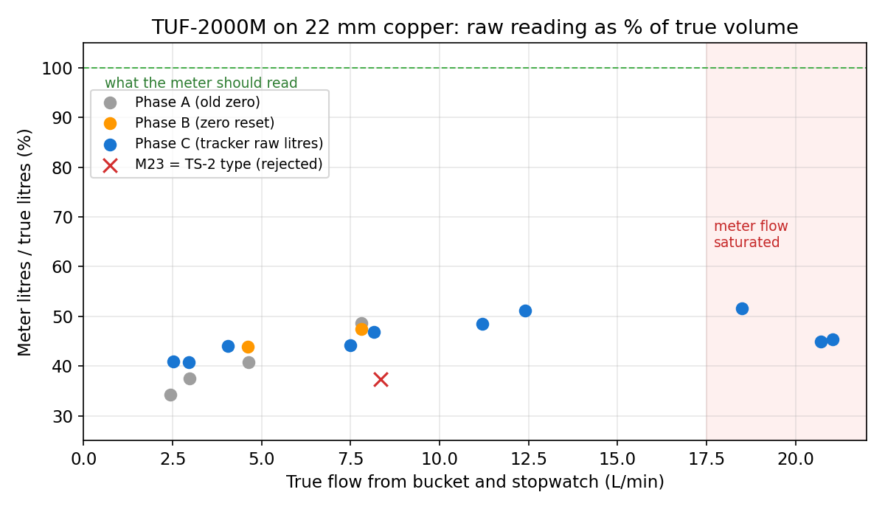
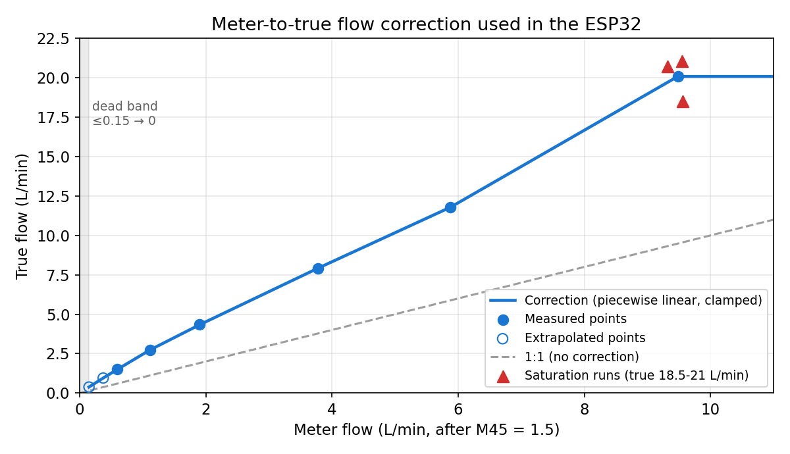

# 04 · Calibration and Testing

[← Back to README](../README.md) · Raw data: [`data/calibration_runs.csv`](../data/calibration_runs.csv), [`data/lookup_table.csv`](../data/lookup_table.csv), [`data/verification_draws.csv`](../data/verification_draws.csv)

## Method

| Element | Detail |
|---|---|
| Reference volume | Marked 4 L, 10 L and about 20 L containers, read at eye level. Typically ±5 %, up to ±8 % on fast 20 L fills |
| Time | Stopwatch → true flow = litres ÷ minutes |
| Sources | **Sink mixer**: tops out at about 7.8-8.2 L/min (aerator-limited). **Outside tap**: up to about 21 L/min. Both are downstream of the meter |
| Untouched | The stopcock was never moved during tests |
| Meter state | Standard S, W method, 24.41 mm, M45 = 1.5 (from Phase A on) |
| What was compared | Phases A-B: the meter's display total. Phase C: the ESP32's **raw-litre integral of the meter's own flow** for that one draw |

The Phase C approach is the key improvement. The ESP32 integrates the *uncorrected* meter flow separately for every draw, so each bucket gives one clean **ratio = meter litres ÷ true litres**. No display reading or rounding is involved.

## Phase A: baseline (factory zero)

| Tap | True L | Time | True L/min | Meter L | Ratio | Meter flow L/min | Re |
|---|---|---|---|---|---|---|---|
| Sink ⅔ | 16 | 3:27 | 4.64 | 6.53 | 40.8 % | 1.89 | about 1800 |
| Sink low | 10 | 4:07 | 2.43 | 3.42 | 34.2 % | 0.83 | 700-800 |
| Sink low | 16 | 5:23 | 2.97 | 6.0 | 37.5 % | 1.12 | about 1000 |
| Sink full | 16 | 2:03 | 7.8 | 7.77 | 48.6 % | n/a | about 3000 |

Two untimed 16 L runs read 44-45 %. Repeat full-open runs read 43.75-48.75 %.

**Finding:** the meter reads **less than half**, and the shortfall is **worse at low flow**.

## Phase B: zero reset and transducer-type test

The zero was reset with M43 (factory zero), then M42 (set zero) with the tap shut. M44 was confirmed at 0.

| Test | True L/min | Ratio | Notes |
|---|---|---|---|
| Sink ⅔, 16 L in 3:28 | 4.62 | 43.9 % | Was 40.8 %. The zero lifted the slow end only |
| M23 = "TS-2" type, sensors unmoved | 8.35 | **37.4 %** | M91 rose to about 110 %. Rejected |
| Standard S restored, full open | 7.8 | 47.5 % | Matches Phase A |

**Finding:** the zero was a contributing factor, not the main cause.

## Phase C: raw-litre ratios across the full range

| Run | True L/min | Meter raw L | Ratio | Peak (corrected) |
|---|---|---|---|---|
| Sink low 10 L, 3:23 | 2.96 | 4.08 | 40.8 % | n/a |
| Sink low 10 L, 3:58 | 2.52 | 4.10 | 41.0 % | n/a |
| Sink ⅔ 10 L, 2:28 | 4.05 | 4.40 | 44.0 % | n/a |
| Sink full 10 L, 1:13.5 | 8.16 | 4.69 | 46.9 % | 9.5 |
| Outside 20 L, 2:40 | 7.5 | 8.85 | 44.3 % | 10.4 |
| Outside 20 L, 1:47 | 11.2 | 9.70 | 48.5 % | 14.1 |
| Outside 20 L, 1:37 | 12.4 | 10.21 | 51.1 % | 16.0 |
| Outside 21 L, 1:08 | 18.5 | 10.84 | 51.6 % | 22.7 |
| Outside about 21.75 L, 1:03 | 20.7 | 9.79 | **45.0 %** | 24.7 |
| Outside 20 L, 0:57 | 21.05 | 9.07 | **45.4 %** | 23.9 |

### Saturation discovered

At true flows of 18.5, 20.7 and 21.05 L/min the meter's own flow showed 9.56, 9.32 and 9.55 L/min. **The meter stops rising at about 9.5 L/min**, which is about 0.5 m/s on its scale, while the real flow keeps increasing. That is why the ratio dips at the top end. Two independent runs confirmed it.

The cause is not yet diagnosed. Candidates are a timing-range limit on thin small-bore pipe, air or bubbles at speed, or signal lock. The next step is to watch M08, M90 and M91 during a full-open draw.

## Why it under-reads: theories tested

| Theory | Result |
|---|---|
| Units / m³/h conversion | Ruled out. The display and Modbus agree |
| Wall thickness setting (0.7 / 0.9 / 1.2 mm) | Small effect. 0.7 mm moved M91 to about 101 % but the under-read remained |
| Zero point / M44 offset | Contributes at low flow only |
| Transducer type setting | Standard S better than TS-2 (48.6 % vs 37.4 %) |
| V method | Impossible (negative spacing) |
| Bend / stopcock too close | Estimated at 10-15 % at worst, not 50 % |
| Laminar/turbulent profile factor | 0.75 → 0.80 explains about 7 points only |
| Offline compensation (M83), empty-pipe threshold (M29), power cycles | Ruled out |
| **Acoustic model mismatch** | **Best-supported.** TS-2 is rated DN25 and up. On 22 mm copper with a 0.9 mm wall, sound can travel partly in the wall as a guided wave, so the meter's straight-ray model gives a stable but flow-dependent shortfall |

## The correction

Below M45's maximum of 1.5 the remaining error is not a single number. A plain multiplier (2.17) left slow draws 9 % low, and a straight line (1.82x + 0.98) left them 21 % high. A quadratic stopped working once saturation was found.

The final approach is a **piecewise-linear lookup table** from meter L/min (M) to true L/min (Q):

| M (meter) | 0.15 | 0.375 | 0.6 | 1.12 | 1.905 | 3.78 | 5.88 | 9.48 |
|---|---|---|---|---|---|---|---|---|
| **Q (true)** | 0.38 | 0.95 | 1.5 | 2.74 | 4.335 | 7.92 | 11.79 | 20.08 |
| Source | extrap. | extrap. | measured | measured | measured | measured | measured | saturation |

Rules applied around the table:

- **M ≤ 0.15:** returns **0** (dead band).
- **M ≥ 9.48:** returns **20.08** (clamped). "Flow At Meter Limit" turns on from M ≥ 9.28.
- **Drift guard:** if M stays below 0.9 for more than 120 s, the output is forced to 0 and "Low Flow Suppressed" turns on.

### Fitting your own table

1. Do 10 L to 20 L bucket runs at five or more tap settings covering your real flow range.
2. For each run, note true L/min (litres ÷ minutes) and the **average meter L/min**, which is raw litres ÷ minutes.
3. Sort by meter L/min. Those pairs become `M[]` and `Q[]`.
4. Add one point near the dead band by extrapolating the low-end ratio.
5. Re-fit whenever the transducers move or M45, M23, M24 or the zero changes.

## Verification

Eight 10 L draws against the fitted table:

| Bucket | Tracker | Error | Duration | Peak L/min |
|---|---|---|---|---|
| 10 L | 9.8 | −2 % | 55 s | 13.5 |
| 10 L | 10.5 | +5 % | 40 s | 20.1 |
| 10 L | 9.0 | −10 % | 1:25 | 8.7 |
| 10 L | 9.8 | −2 % | 50 s | 14.2 |
| 10 L | 9.9 | −1 % | 40 s | 20.1 |
| 10 L | 9.8 | −2 % | 45 s | 16.5 |
| 10 L | 8.8 | −12 % | 30 s | 20.1 |
| 10 L | 8.9 | −11 % | 35 s | 20.1 |

**What the verification runs show:**

- **11-15 L/min draws:** averaged **9.96 L** against 10 L, under 1 % error.
- **The two shortest, fastest draws (30-35 s):** read 11-12 % low. These are edge effects from start-threshold timing and 0.5 s sampling, and they shrink with draw length.
- **The 7-9 L/min draw:** read 10 % low. Scatter is highest near the laminar-to-turbulent transition.
- **Small draw:** a 0.5 L glass of water read **0.5 L**.
- **Toilet flush:** read 3.2 L over 25 s. The true cistern volume has not been measured yet.

### Accuracy statement

| Condition | Expected error |
|---|---|
| Typical draws, 2.5-12 L/min, longer than about 40 s | ±3-5 % |
| Fast draws, about 20 L/min | ±8 % |
| Above about 20 L/min | Reads as 20 L/min (under-reads) |
| Below about 0.4 L/min | Not counted |
| Very short fast draws | Up to about 12 % low |

## Other tests

| Test | Result |
|---|---|
| Modbus timing before and after the fix | See [docs/03](03-modbus-register-map.md) |
| Steady-low-flow alert | Fired and confirmed on the phone |
| Utility meter totals vs ESP32 total | Agree after recalibration to 0 |
| Float total (address 114) vs meter M02 | Match (0.632 m³) |
| Real showers by timing | 140 L / about 9 min and 200 L / about 12 min (about 16 L/min) |

### Still to run

- **Missing-data test:** do a 10 L draw just after a 60 s stats poll. Compare the rise in `Total (Positive)` with `Last Draw Raw Volume`; expect them within about 2 %.
- **Long-term check:** compare against the water company's dial reading over several weeks.
