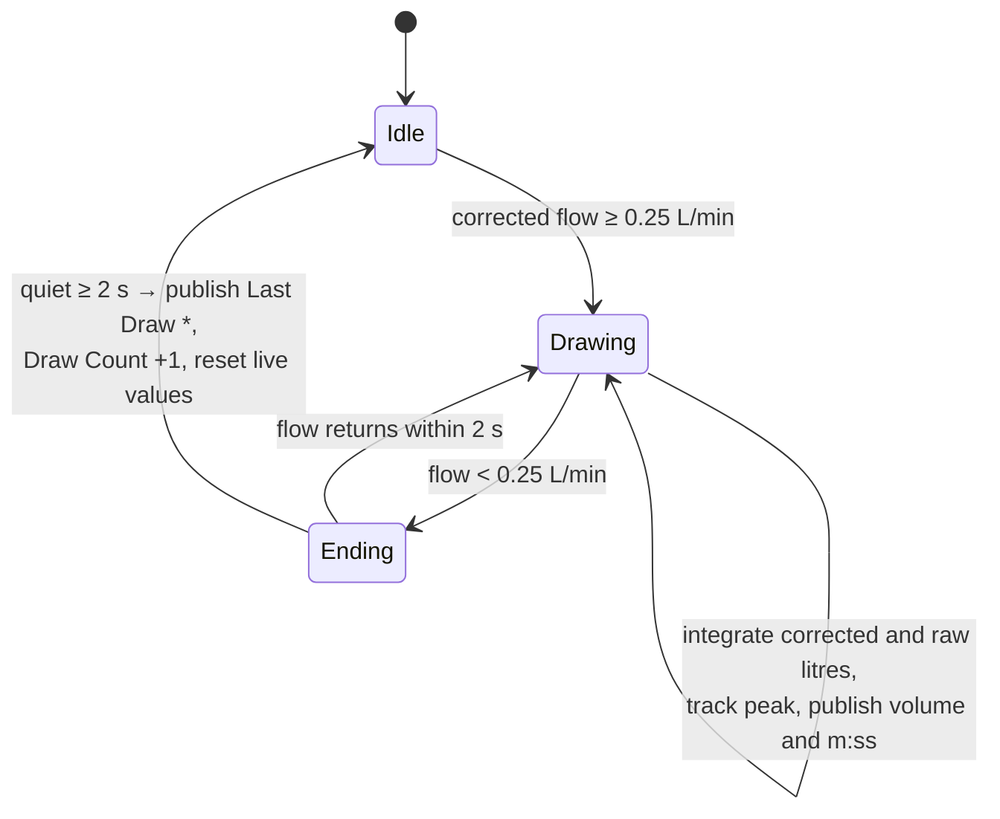
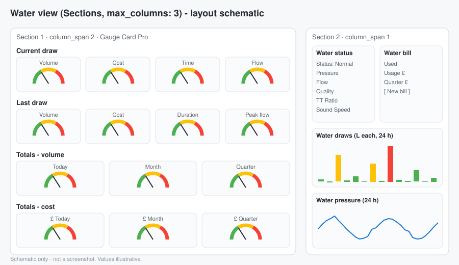

# 05 · Home Assistant Integration

[← Back to README](../README.md) · Config: [`config/homeassistant/`](../config/homeassistant/) · Dashboard: [`config/dashboards/`](../config/dashboards/)

## Entity naming

ESPHome entities appear as `sensor.utility_room_esp32_utility_room_<name>`, because the device "ESP32 Utility Room" sits in the area "Utility Room".

**Always check your real IDs** in Developer tools → States before pasting templates.

Two behaviours to know about:

- **Renaming in ESPHome creates a new entity.** The old one becomes `unavailable` and must be deleted under Settings → Entities.
- **YAML template sensors have no device.** Find them on the Entities tab, not under a device.

## Totals: utility meters

| Meter | Cycle |
|---|---|
| `sensor.water_daily` | daily |
| `sensor.water_weekly` | weekly (optional) |
| `sensor.water_monthly` | monthly |
| `sensor.water_quarterly` | quarterly (matches calendar-quarter charging) |
| `sensor.water_yearly` | yearly (optional) |

- **Source:** all of them read `Mains Water Used`, the ESP32's corrected litres integral (restored over reboots).
- **`unique_id` is required** to set display precision in the UI, and it needs a **full restart**.
- **Zeroing:** use `utility_meter.calibrate` with value `"0"`. `reset` only works with tariffs.

## Tariff and cost model

From the water bill:

| Component | Rate |
|---|---|
| Water | £2.1838 per m³ |
| Sewerage | £2.9761 per m³, charged on **95 %** of water volume |
| **Variable total** | **≈ £5.0111 per m³ ≈ £0.005011 per litre** |
| Fixed (per quarter) | £13.52 water + £8.46 sewerage + £21.36 surface water = **£43.34** |

Cost sensors:

| Sensor | Rounding | Notes |
|---|---|---|
| Water Cost Today | 3 dp | |
| Water Cost This Month | 2 dp | |
| Water Cost This Quarter | 2 dp | Includes the £43.34 fixed charge |
| Current Draw Cost | 3 dp | Live while water runs |
| Last Draw Cost | 3 dp | |
| Water Since Last Bill / Cost Since Last Bill | 1 dp / 2 dp | Floored at 0 |

### Billing-period counter

Meter reads do not fall on quarter boundaries, so the bill period has its own counter. On the day of a read, press **New bill** on the dashboard. It runs `script.water_new_bill_starts_now`, which copies `Mains Water Used` into `input_number.water_bill_start`. "Since last bill" is then the difference.

## Per-draw tracking (on the ESP32)

Draw tracking runs on the board, not in HA. It needs 0.5 s resolution, and it must keep working if HA restarts.

Published at the end of each draw:

- Last Draw **Volume**, **Raw Volume**, **Duration** (e.g. "2 min 41 s"), **Peak Flow** and **Finished** time.
- A one-line **Log**, in the format `YYYY-MM-DD HH:MM:SS | x.xx L | m min ss s | peak y.yy L/min`.

Two details make this work:

- **Repeated identical draws:** HA ignores a state that hasn't changed, so two identical draws would merge. The firmware adds **+0.001 L** when a volume equals the previous one.
- **Duration excludes the end gap,** so the time shown is the time water actually ran.

## Sub-metering

### Washing machine

| Element | Detail |
|---|---|
| Detector | ThirdReality Zigbee vibration sensor |
| Running sensor | `binary_sensor.washing_machine_running`: delay_on 2 min, delay_off 10 min |
| Start | Copy `Mains Water Used` into `washing_machine_start_reading` |
| End | Usage = (now − start) ÷ 1000 m³, floored at 0 |

### Master en-suite shower (sensor fusion)

`Master En-Suite Shower Running` is true when all of these hold:

- the en-suite motion sensor is occupied, **and**
- corrected mains flow is **> 3.0 L/min**, **and**
- the washing machine is **not** running, **and**
- both garden-tap irrigation sensors read 0.

It uses delay_on 30 s and delay_off 2 min. There are three automations:

1. **Capture Start:** records the start litres and baseline humidity, and clears "confirmed".
2. **Humidity Confirmation:** sets "confirmed" when humidity rises ≥ 10 points above baseline. This is informational and does not change the litres.
3. **Calculate Usage:** usage in m³ when the shower stops.

The first 30 s before "running" turns on is not counted. At 16 L/min that is about 8 L, around 5 % of a typical shower. A start-rewind fix is on the roadmap.

> Replace the motion, humidity, vibration and garden-tap entity IDs in `templates.yaml` and `automations.yaml` with your own.

## Alerts

| Alert | Trigger | Action | Status |
|---|---|---|---|
| Steady low water flow | Uncorrected meter flow between 0.15 and 0.9 L/min for 10 min | Phone + persistent notification | ✅ tested |
| Sensors slipped | Quality < about 75 %, TT ratio outside about 100-107 %, strength outside about 70-82, or error code > 0, for 10 min | Phone + persistent notification | ⏳ spec only (thresholds from 1-2 weeks of baseline data) |

For phones, use `action: notify.send_message` with `target: entity_id: notify.<your_phone>`. The legacy `notify.mobile_app_*` *service* name is **not** an entity, and this action fails silently with it.

## Dashboard

The view uses the **Sections** layout with `max_columns: 3`.

**Left section (2 columns wide): 14 gauges** made with Gauge Card Pro.

| Row | Gauges |
|---|---|
| Current draw | volume, cost, time, flow |
| Last draw | volume, cost, duration, peak flow |
| Totals | today, month, quarter (volume) |
| Totals £ | today, month, quarter (cost) |

**Right section (1 column wide):**

- Status panel: Normal / Check meter, pressure, flow, quality, travel-time ratio, sound speed.
- Bill panel: used, usage £, quarter £, and the **New bill** button.
- 24 h draws bar chart, coloured green / amber / red at 80 and 170 L.
- 24 h pressure trend (5-minute averages).

### Gauge needle shaping

Linear gauges hide small draws: a 2 L draw on a 250 L scale barely moves. Each gauge therefore maps its value onto a 0-100 arc in three zones:

| Zone | Arc | Mapping |
|---|---|---|
| Green | 0-33.3 | **Square-root** curve up to the amber threshold, so small values move visibly |
| Amber | 33.3-66.6 | Linear up to the red threshold |
| Red | 66.6-100 | Linear up to full scale, then clamped |

The real-unit thresholds (amber start / red start / full scale) are:

| Gauge | Bands |
|---|---|
| Draw volume | 80 / 170 / 250 L |
| Draw cost | £0.40 / £0.85 / £1.25 |
| Draw time | 300 / 630 / 930 s |
| Flow | 8 / 18 / 20.1 L/min |
| Today | 550 / 900 / 1,200 L |
| Month | 16,500 / 27,000 / 36,000 L |
| Quarter | 50.6 / 82.8 / 110.4 m³ |
| £ Today | £2.75 / £4.50 / £6.00 |
| £ Month | £82.70 / £135.30 / £180.40 |
| £ Quarter | £296.90 / £458.30 / £596.60 (including fixed charges) |

The volume bands follow real use: about 880-940 L/day from bills and about 16 L/min showers.

### Front-end gotchas

- **Gauge Card Pro:** needs the resource `/hacsfiles/gauge-card-pro/gauge-card-pro.js` (JavaScript module) and a hard refresh.
- **Column width:** Sections caps columns at about 500 px. The theme `water_wide` raises it to 800 px.
- **ApexCharts bar colours:** use `apex_config.plotOptions.bar.colors.ranges`. `color_threshold` did not colour columns.
- **Error-code status rows:** use `numeric_state below: 0.5`, because the state is `0.0`, not `"0"`.

## Reload vs restart cheat sheet

| Change | Needs |
|---|---|
| Template sensors | Developer tools → YAML → **Template entities** reload |
| `utility_meter`, `input_number`, `recorder` | **Full restart** |
| Theme | `frontend.reload_themes` |
| ESPHome YAML | Install (OTA) |
